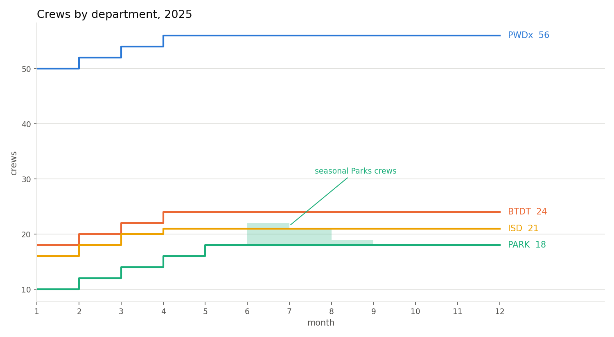
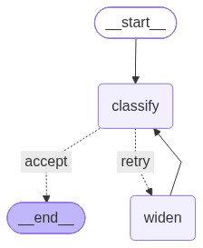

# Boston 311: Intake Routing and Crew Staffing

DADS 5250, Generative AI in Practice. Module 7 Hackathon. Gqwetha Ncube.

Two questions about one service system, answered from City of Boston 311 records.

**Intake.** A resident writes a message in plain language. Which of Boston's own
request types is it, which queue does it belong to, and which department owns it?

**Staffing.** Given a forecast of 2025 demand, how many crews should each of the
4 departments with crews run in each month, and what does that plan cost?

The 2 halves meet at one point. A misrouted request becomes demand in the wrong
department's queue, which changes crew counts and the overdue bill. Routing
accuracy is reported here in dollars as well as in percent.

---

## Quick start

The notebook executes without the raw data. Every cell that opens a raw CSV
tests `HAS_RAW` first and reads the processed tables under `data/processed/`
instead, all 10 of which are committed here.

```
git clone https://github.com/gqwetha/dads5250-boston311-crew-planner.git
cd dads5250-boston311-crew-planner
pip install -r requirements.txt
jupyter notebook NCUBE_Hackathon_Boston311.ipynb
```

Built and verified on Python 3.11.14, Windows, Anaconda. Versions are pinned in
`requirements.txt`.

The crew model needs no key, no network and no data file. Its tests run alone:

```
python -m unittest discover -s tests
```

Expect `Ran 27 tests` and `OK`.

A model key is needed only for the intake assistant sections. Set
`OPENAI_API_KEY` in the environment before launching Jupyter. No key is written
into any cell.

**Cost of a full run.** Restart and Run All re-runs every model call in the
notebook: 4 conditions over 60 labeled messages, plus a stability check that
repeats a subset. Those outputs are saved in the committed notebook and in
`data/processed/assistant_results.csv`, which lets a reader follow the argument
without re-running them.

**Reproducing from source.** The 3 raw files total about 500 MB and are not
committed. Download them from
[311 Service Requests on Analyze Boston](https://data.boston.gov/dataset/311-service-requests)
into `data/raw/` as `311_service_requests_2023.csv`, `_2024.csv` and `_2025.csv`.
`HAS_RAW` then reads them and every aggregation is rebuilt from source.

---

## Results

### The 2025 crew plan

| Department | Crews Jan | Crews Dec | Hires | Releases | Overdue | On time | Cost, USD |
|---|---|---|---|---|---|---|---|
| PWDx | 50 | 56 | 6 | 0 | 9,733 | 93.8% | 7.34M |
| BTDT | 18 | 24 | 6 | 0 | 65 | 99.9% | 2.53M |
| PARK | 10 | 18 | 8 | 0 | 0 | 100.0% | 2.06M |
| ISD | 16 | 21 | 5 | 0 | 0 | 100.0% | 2.84M |
| **Total** | | | **25** | **0** | **9,798** | **96.5%** | **14.77M** |

Parks adds 4 seasonal crews in June, 3 in July and 1 in August, which need no
hiring lead time and no release cost.

Every hire falls in February through May. January cannot change, because hiring
takes a month and the January counts are given. No crew is released all year:
demand never falls far enough for a quarter of an annual salary to be worth
paying.

*Scope: a plan built on a forecast, priced under the stated cost rules. The
starting crew counts are the planning assumption given with the problem, not
Boston's actual staffing.*



### What the intake assistant does

60 labeled resident messages, written by hand: 40 clear, 20 phrased to fall
between 2 departments.

| Condition | Overall | Clear, 40 | Boundary, 20 | Type in taxonomy |
|---|---|---|---|---|
| no type list | 83.3% | 97.5% | 55.0% | 1.7% |
| retrieved list of 8 | 83.3% | 90.0% | 70.0% | 93.3% |
| retrieved list, with re-route | 85.0% | 92.5% | 70.0% | 98.3% |
| whole taxonomy, no retrieval | 90.0% | 97.5% | 75.0% | 100.0% |

The last column separates the first row from the other 3. With no type list the
model names the right department 83.3% of the time and names a request type
Boston uses 1.7% of the time. Its answers read as reasonable and no queue would
accept one. Department accuracy on its own hides that completely.

The fourth condition is the control, and it wins. Every type is in front of the
model from the start, it names a usable type on all 60 messages, and it scores
highest on both tiers. That is a result about the size of this taxonomy rather
than about retrieval: 150 types come to 3,924 characters, which fits in a
prompt. Retrieval is built for lists that do not fit. At this scale the whole
list is the better choice, and running the control is what showed it.

Grounding is what the first row lacks. On the boundary tier the 3 grounded
conditions score 70.0% to 75.0% against 55.0% with no list. On the clear tier
the ungrounded baseline matches the best of them at 97.5%, because an obvious
pothole needs no list to route.

The re-route raises taxonomy compliance from 93.3% to 98.3% and leaves 1 message
unmatched against 4 for retrieval alone. Returning nothing is the correct answer
for a message describing something the city has no type for.

### Pricing the routing error through the crew plan

The measured error rates applied to a full year of demand:

| Error rates applied | Overdue | On time | Cost, USD |
|---|---|---|---|
| none | 9,798 | 96.5% | 14.77M |
| re-route graph, all 60 messages | 19,348 | 93.0% | 14.97M |
| re-route graph, boundary tier only | 49,461 | 82.1% | 15.66M |

A routing accuracy of 85% is not an abstract score. Carried across a year it
doubles the overdue count and adds 0.19M USD to the bill, because work moves into
departments that were not staffed for it. If every message were as ambiguous as
the boundary tier, the same model would cost 0.88M more and push on-time
performance from 96.5% to 82.1%.

### The forecast against what Boston recorded

No step that builds the forecast reads the 2025 file. January through October is
used for the comparison, because established request types read zero in November
and December, which indicates incomplete reporting in those 2 months.

| Department | Forecast | Recorded | Level error | MAPE | Shape-only MAPE |
|---|---|---|---|---|---|
| PWDx | 136,047 | 115,415 | -15.2% | 21.7 | 6.6 |
| BTDT | 69,011 | 68,688 | -0.5% | 3.7 | 3.8 |
| PARK | 16,773 | 13,300 | -20.7% | 28.7 | 13.4 |
| ISD | 15,909 | 15,437 | -3.0% | 8.6 | 8.5 |

Most of the error is level, not shape. PWDx's MAPE of 21.7 falls to 6.6 once the
annual total is corrected, which means the monthly profile carried forward well
and the volume assumption did not.

What that error cost:

| | Cost, USD | On time | Hires |
|---|---|---|---|
| the committed plan | 14.49M | 99.8% | 25 |
| a plan built knowing the demand | 13.47M | 97.1% | 14 |
| **cost of the forecast error** | **+1.02M** | | |

The sensitivity analysis was built before the 2025 file was opened. Its 90% row
priced the cost of being wrong by that margin at 1.05M. The actual figure was
1.02M.

---

## Architecture



A LangGraph state machine. A message is classified against retrieved candidate
types, then tested for membership in Boston's own type list. A type that is not
in the list sends the state to a widening node, which triples the retrieval
window and classifies again. The loop is bounded at 2 passes, after which an
unmatched message is reported as unrouted.

The routing condition is a membership test against the data, not a confidence
score the model produced about itself.

`staffing.py` has no model in it. The crew plan is arithmetic over a forecast,
and nothing about it needs a prompt.

---

## Techniques used

| Technique | Where | Why it is needed there |
|---|---|---|
| Prompt engineering | the 4 classifier conditions | the comparison between conditions is a prompt comparison |
| Structured output | every classification | a Pydantic schema with a constrained department field, because the result feeds a cost model, not a reader |
| RAG | candidate type retrieval | a type list is what lifts taxonomy compliance from 1.7% to 93.3%. The fourth condition tests whether retrieval or the list did that work, and reports that at 150 types the list alone is enough |
| Agents and LangGraph | the re-route loop | a result outside the taxonomy needs another attempt with different inputs, which is control flow, not a longer prompt |

No technique is present without a measured result attached to it.

---

## Error handling

Model calls retry transient API failures and rate limits with backoff, with a
timeout that prevents a hung call from blocking the run. A call that fails after
its retries returns an unrouted result and the run continues. An empty message
is rejected before any model call, which the demo cell prints.

---

## Testing

27 tests on the crew model, all passing, with no model call and no data file.
Every expected value is arithmetic from the stated rules, worked out by hand.
None is recorded from an earlier run.

Covered: monthly capacity, crews needed and its rounding, allowed backlog,
January being fixed under all 3 policies, the smoothed policy's 2-crew step
limit, cost equalling salaries when nothing goes late, both penalty tiers,
seasonal crews limited to Parks and to April through October, release cost at a
quarter of annual salary, and the scenario helpers.

Not covered, deliberately: the overdue formula and the oldest-first backlog
ageing. A test of either would restate the implementation and pass whatever the
implementation did.

---

## Limitations

1. No crew counts are given for 2023 or 2024, and the 311 data contains none.
   Checks against those years fix crews at the January 2025 counts. What those
   checks measure is demand and target behaviour.
2. The 2025 comparison covers January through October, for the reason given
   above.
3. The forecast reuses the monthly shape of the 2 recorded years. A structural
   change in reporting would break it, and the 2025 comparison is what tests
   whether it broke.
4. Neighbourhood response rates reflect department mix as much as service level.
   The analysis separates the 2, and that separation is the finding.
5. A crew is interchangeable within a department. Different skills inside one
   department are outside the model.
6. The 60 test messages were written by hand for this project. They were
   written to be realistic; the 311 data has no free-text resident descriptions
   to sample from.

---

## Repository

```
NCUBE_Hackathon_Boston311.ipynb   the submission
staffing.py                       the crew model, no model calls
build_test_messages.py            builds the labeled test set
tests/test_staffing.py            27 tests
data/test_messages.csv            60 labeled messages, 3 difficulty tiers
data/processed/                   10 tables, committed
routing_graph.png                 the LangGraph structure
crew_plan_2025.png                crews by department across 2025
requirements.txt
```

`.gitignore` names `data/raw/` and not a `*.csv` pattern, which keeps
the processed tables committable while excluding the 3 large sources.

---

## Data

City of Boston 311 service requests, 2023, 2024 and 2025, from
[Analyze Boston](https://data.boston.gov/dataset/311-service-requests).
Public domain. Downloaded 21 October 2026. All 3 files share the same 30 columns
in the same order; 8 of the 30 are read here.

Crew capacities, annual costs, starting crew counts and the penalty amounts are
planning assumptions given with the problem, used as stated. The request data is
Boston's own.

---

## Use of AI Disclosure

The Generative AI component of this project is the Boston 311 intake assistant,
the working AI application built with prompting, structured output, RAG and
LangGraph to route natural-language resident complaints into the city's request
types and queues.

An AI assistant was used for code review, syntax drafting and grammatical polish
of the written observations.

**Data integrity and ground truth.** Every quantitative figure in the notebook
and in this README is produced directly by reproducible cell executions.

**Evaluation data.** The 60 test labels were assigned by hand from Boston's own
request type list and verified against historical data rather than generated by
a model.
